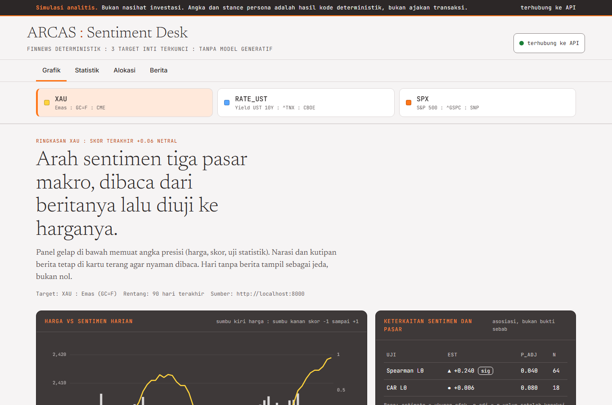
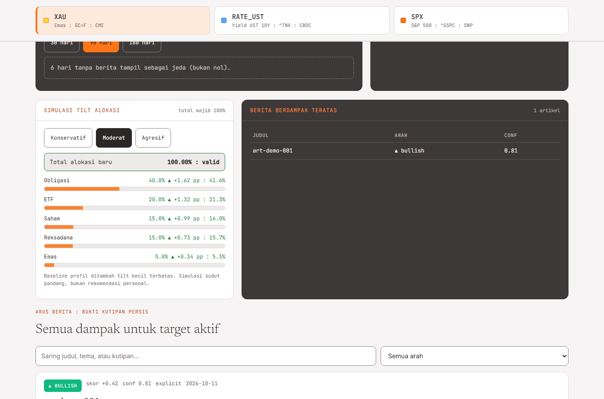
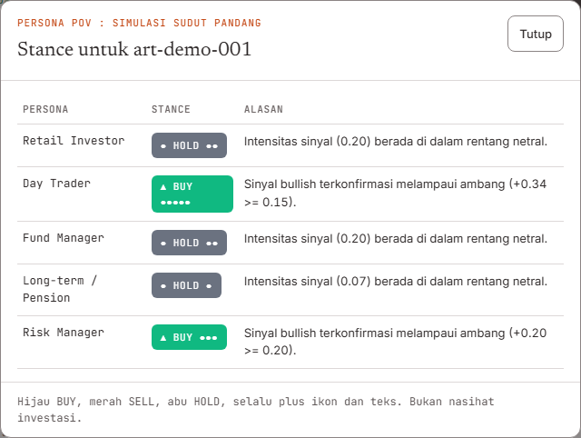
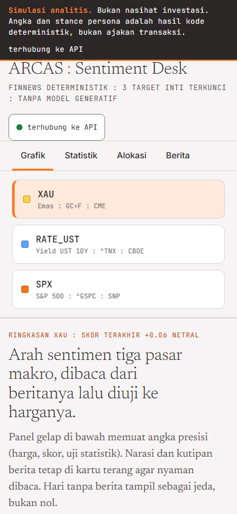
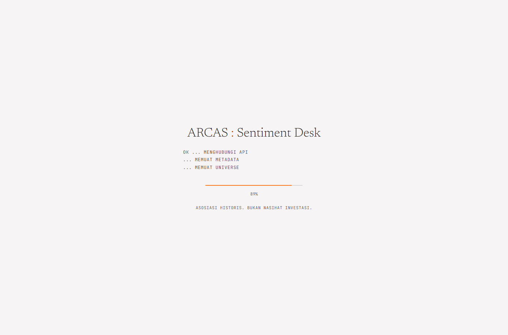
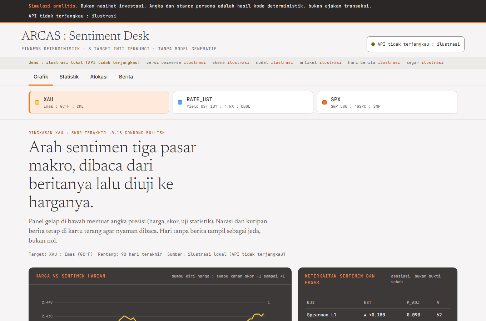

# frontend/GUI/ — Static ECharts HTML Dashboard (FR-15)

Dashboard web statis offline (zero-build, zero-server) untuk artefak presentasi sidang:
- `src/css/`: Styling ikut `THEME.md` v0.1 (Claude × Bloomberg, offline adaptasi): font Newsreader/Inter/JetBrains Mono via `@font-face` lokal `src/fonts/`, Base `#F6F4F4`, Surface `#FFFFFF`, Technical `#3E3939`, Accent `#FF7517`, Text `#2C2727`, semantik UP/DOWN/HOLD + palet grafik; proporsi 65/20/10/5, filosofi 70% Claude + 30% Bloomberg.
- `src/js/`: Inisialisasi Apache ECharts offline (vendored, zero-CDN).
- `templates/`: Template HTML single-file yang di-inject JSON payload dari backend CLI `report`.
- **Fitur**: Dual-axis sentimen vs harga, tab 3 target inti (`XAU`, `RATE_UST`, `SPX`, dirender dinamis dari `/api/universe`), evidence table, statistik, kartu Allocation Tilt & Persona POV.
- **Splash + provenance (Upgrade.md UI-01)**: `src/js/splash.js` menunggu data nyata (`Splash.done()` setelah `/api/meta` + `/api/universe`), kunjungan pertama splash penuh, reload cukup skeleton. `src/css/splash.css` memakai token `theme.css`, bukan `tokens.css` komponen (yang masih CDN). Data Provenance Bar menampilkan mode `live`/`demo`, versi universe/skema/model, cakupan artikel & hari berita.
- **Audit waktu (Upgrade.md UI-02)**: tiap kartu dampak memuat baris audit `terbit vs sesi efektif vs cut-off` (join `articles` + `article_targets` + `asset_master` di `/api/impacts`), berita setelah cut-off bertanda "masuk sesi berikutnya". Panel statistik menampilkan periode uji dan lag yang diuji.
- **Evidence drawer (Upgrade.md UI-03)**: tiap kartu punya `
` "Bukti dan model" berisi probabilitas tiga kelas per model (`p_pos/p_neu/p_neg` dari tabel `sentiments`), badge "Hanya judul yang dianalisis", dan tautan sumber asli. Bagian yang belum terekam di DB selalu disebut jujur, tidak pernah dipalsukan.
- **Output**: File beku `outputs/report.html` (dapat dibuka langsung di browser).

## Tampilan Dashboard (`docs/tampilan-dashboard/`)

Hasil tangkapan layar dari data demo (API lokal + `data/finews.db` terisi):

