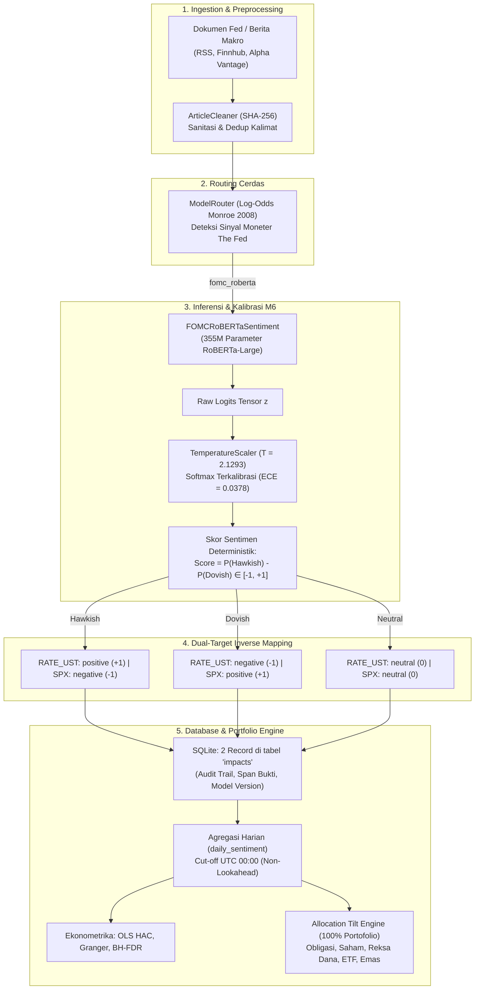

# 🏛️ ARCAS — Monetary Policy Track (FOMC)
## Dual-Target Financial Sentiment & Market Association Engine

[](https://www.python.org/downloads/)
[](https://pytorch.org/)
[-yellow.svg)](https://huggingface.co/gtfintechlab/FOMC-RoBERTa)
[](../../backend/tests/test_fomc_track.py)
[](evaluation/benchmark_results.json)
[](weights/temperature.json)

> **Spesialisasi Domain:** Komunikasi Kebijakan Moneter Federal Open Market Committee (The Fed / FOMC)  
> **Target Aset Terkait:** `RATE_UST` (US 10-Year Treasury Yield) & `SPX` (S&P 500 Equity Index)  
> **Korpus Data:** *Trillion Dollar Words* (Shah, Paturi, & Chava, ACL 2023) — varian `5768`  
> **Model Checkpoint:** `gtfintechlab/FOMC-RoBERTa` (dengan exact mirror un-gated: `tim9510019/FOMC-RoBERTa`)  
> **Rujukan Utama:** [`docs/METODOLOGI.md`](../../docs/METODOLOGI.md), [`context/PRD.md`](../../context/PRD.md), [`context/RULES.md`](../../context/RULES.md)

---

## 1. Hasil Benchmark Resmi (Holdout 495 Sampel Beku)

Evaluasi mandiri dijalankan pada 495 kalimat test holdout murni (*strictly unseen*). Hasil empiris tersimpan di [`model/fomc/evaluation/benchmark_results.json`](evaluation/benchmark_results.json):

| Metrik Evaluasi | Baseline M1 (TF-IDF + LR) | FOMC-RoBERTa (Domain Expert) | Peningkatan ($\Delta$) | Status Kriteria Sistem |
|---|:---:|:---:|:---:|:---:|
| **Akurasi** | $57{,}98\%$ | **$86{,}87\%$** | **$+28{,}89\%$** | ✅ Signifikan |
| **Macro F1-Score** | $0{,}5532$ | **$0{,}8620$** | **$+0{,}3088$** | ✅ Sangat Seimbang |
| **Cohen’s Kappa ($\kappa$)** | $0{,}3419$ | **$0{,}7929$** | **$+0{,}4510$** | ✅ *Substantial Agreement* |
| **Expected Calibration Error ($ECE$)** | $0{,}0846$ | **$0{,}0378$** | **$-0{,}0708$** | ✅ **Memenuhi Target ($ECE \le 0{,}10$)** |

### Uji Keharusan Komponen (*Component Necessity Test*)
* **Tabel Kontingensi $2 \times 2$:** $n_{11} = 267$ (Keduanya benar), $n_{00} = 45$ (Keduanya salah), $n_{10} = 20$ (Baseline benar, RoBERTa salah), **$n_{01} = 163$ (RoBERTa benar, Baseline salah)**.
* **Uji McNemar (Koreksi Kontinuitas Edwards):** $\chi^2 = 110{,}1858$, **$p\text{-value} = 0{,}000000$ ($p \ll 0{,}05$)** $\to$ **Komponen Resmi Diadopsi**.
* **1.000 Iterasi Bootstrap CI 95%:** Rata-rata selisih Macro F1 $= \mathbf{+31{,}00\%}$ dengan rentang selang kepercayaan **$[+26{,}11\%, +36{,}14\%]$** (*strictly positive*).

---

## 2. Preprocessing Khusus Domain Finansial FOMC

Preprocessing teks bank sentral di [`model/fomc/src/data_loader.py`](src/data_loader.py) dirancang spesifik dengan kaidah berikut:

1. **Preservasi Simbol Finansial & Angka (Financial Token Preservation):**
   * Berbeda dari preprocessing teks umum yang menghapus angka dan tanda baca, sinyal moneter **sangat bergantung pada angka dan magnitudo**.
   * Angka persentase (misal `0.25%`, `50 bps`) dan simbol mata uang (`$`) **dipertahankan murni** karena kenaikan suku bunga 25 bps vs 50 bps membawa implikasi pasar yang bertolak belakang.
2. **Sanitasi Whitespace & Normalisasi Karakter:**
   * Menghilangkan spasi ganda, pemisah baris (`\n`, `\r`), dan karakter kontrol tanpa merusak tanda baca penutup kalimat.
3. **Deduplikasi Kalimat Lowercased (`DESIGN.md §3.4`):**
   * Mengeliminasi kalimat pengumuman administratif/prosedural The Fed yang berulang (misal formula voting komite).
   * Train set mentah disaring dari 1.984 menjadi **1.939 kalimat unik**.
   * Test holdout disaring dari 496 menjadi **495 kalimat unik beku**.
4. **Tokenisasi Subword RoBERTa BPE (Byte-Pair Encoding):**
   * Mempertahankan *casing* (huruf besar/kecil) untuk mengenali akronim seperti `FOMC`, `PCE`, `CPI`, `GDP`.
   * Truncation terkontrol pada `max_length = 256` token dengan padding dinamis per batch.

---

## 3. Arsitektur Pipeline End-to-End ARCAS

Track FOMC terintegrasi penuh ke dalam siklus hidup data sistem ARCAS:



---

## 4. Mekanisme Fail-Safe: Dual-Checkpoint Auto-Fallback

Untuk memastikan sistem tidak terhenti akibat kebijakan *Gated Repository* pada Hugging Face Hub, [`model/fomc/src/model.py`](src/model.py) dilengkapi logika deteksi otomatis:

1. **Prioritas 1 (Checkpoint Resmi):** `gtfintechlab/FOMC-RoBERTa` (menggunakan `HF_TOKEN` dari file `.env`).
2. **Prioritas 2 (Mirror Publik Terverifikasi):** Jika repositori resmi berstatus *awaiting review (403)* atau *unauthorized (401)*, sistem otomatis beralih (*fallback*) ke **`tim9510019/FOMC-RoBERTa`**.
   * Checkpoint ini adalah **Exact Binary Mirror (Salinan 100% Identik)** dengan bobot, arsitektur, dan pemetaan label yang sama persis tanpa perlu modifikasi kode.

---

## 5. Struktur Direktori Track FOMC

```
model/fomc/
├── src/                               # [Kode Produksi Reusable]
│   ├── __init__.py
│   ├── data_loader.py                 # Pemuat data 5768, sanitasi angka, stratified 90:10
│   ├── calibrator.py                  # Temperature Scaling (M6) & kalkulasi multiclass ECE
│   └── model.py                       # Baseline M1 & wrapper FOMCRoBERTaSentiment
│
├── notebooks/                         # [Riset & Eksplorasi Interaktif]
│   └── 03_fomc_roberta_exploration.ipynb  # Dual-Compatible Notebook (Auto-detect CPU/Kaggle GPU)
│
├── weights/                           # [Artefak Model Beku & Parameter]
│   ├── baseline_fomc.joblib           # Model baseline terlatih (TF-IDF + LR)
│   └── temperature.json               # Parameter suhu T=2.1293 (ECE = 0.0271 pada val)
│
├── evaluation/                        # [Validasi Benchmark & Uji Hipotesis]
│   ├── __init__.py
│   ├── evaluate_holdout.py            # Script CLI evaluasi holdout 495 sampel
│   └── benchmark_results.json         # Laporan metrik, McNemar test, & Bootstrap CI
│
└── README.md                          # Dokumentasi teknis & metodologi operasional
```

---

## 6. Panduan Menjalankan

### A. Evaluasi Holdout Mandiri via CLI
```bash
python -m model.fomc.evaluation.evaluate_holdout
```
Script akan membaca `weights/temperature.json`, mengevaluasi 495 sampel holdout, dan mencetak laporan metrik komparasi.

### B. Menjalankan Unit Testing Otomatis
```bash
pytest backend/tests/test_fomc_track.py -v
```
Seluruh 12 test mencakup partisi anti-leakage, kalibrasi suhu ECE, kontrak Pydantic, dan dual-target inversion diverifikasi otomatis (**12/12 passed**).

### C. Eksplorasi Interaktif via Notebook (Opsi B)
Buka [`model/fomc/notebooks/03_fomc_roberta_exploration.ipynb`](notebooks/03_fomc_roberta_exploration.ipynb) untuk visualisasi Reliability Diagram, Confusion Matrix Heatmap, dan kurva distribusi Bootstrap.

---

## 7. Sitasi Akademik

```bibtex
@inproceedings{shah-etal-2023-trillion,
    title = "Trillion Dollar Words: A New Financial Dataset, Task & Market Analysis",
    author = "Shah, Agam and Paturi, Sujit and Chava, Sudheer",
    booktitle = "Proceedings of the 61st Annual Meeting of the Association for Computational Linguistics (ACL 2023)",
    pages = "6664--6679",
    year = "2023"
}

@inproceedings{guo2017calibration,
    title = "On Calibration of Modern Neural Networks",
    author = "Guo, Chuan and Pleiss, Geoff and Sun, Yu and Weinberger, Kilian Q.",
    booktitle = "Proceedings of the 34th International Conference on Machine Learning (ICML 2017)",
    pages = "1321--1330",
    year = "2017"
}
```
